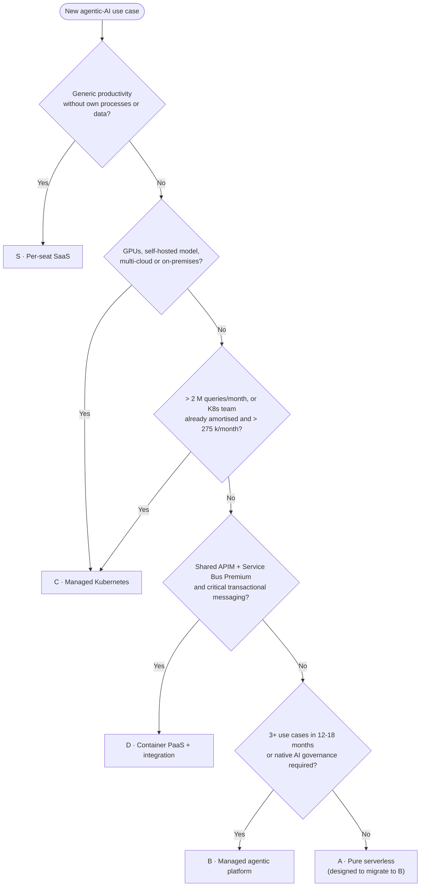

# FinOps for Agentic-AI Architectures on Azure

[](https://github.com/nubenetes/finops-agentic-ai-architectures/actions/workflows/ci.yml)
[](docs/finops-agentic-ai-architectures-study.md)
[](https://www.finops.org/framework/)
[](calculator/assumptions.json)
[](docs/finops-agentic-ai-architectures-study.md#13-regional-analysis-europe-and-the-united-states)
[](calculator/)
[](LICENSE)

A vendor-neutral, industry-agnostic **FinOps study and decision model** for enterprise **agentic-AI platforms** (assistants and agents with deterministic guardrails) on Microsoft Azure. It helps any organisation — from a start-up to a global corporation, from a 1,000-query pilot to a multi-million-query B2C app — decide **which architecture is the most cost-effective, and when to switch from one to another**.

> 📖 **Full study (Markdown with Mermaid diagrams, rendered natively by GitHub)**: [docs/finops-agentic-ai-architectures-study.md](docs/finops-agentic-ai-architectures-study.md)

## What it compares

| Option | Stack | In one sentence |
| :--- | :--- | :--- |
| **A · Pure serverless** | Azure Functions Flex Consumption + Durable Functions | Lowest fixed cost; best for 1–2 simple agents |
| **B · Managed agentic platform** | Microsoft Foundry (Agent Service, Model Router, Evaluations, Guardrails) + Functions | Best TCO from 3+ use cases thanks to native governance |
| **C · Managed Kubernetes** | AKS Automatic + Gateway API + Kafka/Event Hubs | Justified by GPUs, portability or millions of queries with an existing K8s team |
| **D · Container PaaS + enterprise integration** | Container Apps + Service Bus Premium + API Management Standard v2 | Only when APIM/Service Bus are already shared corporate services |
| **S · Per-seat SaaS** | Commercial assistant licensed per user | Benchmark for generic productivity |

Across **three security profiles** (P1 Essential, P2 Standard, P3 Regulated), **three query profiles** (light RAG, verified RAG, multi-step agentic), **sixteen Azure regions** (Spain Central, the main EU regions, UK, Switzerland and the major US regions) and any volume from 1,000 to 5 million queries per month. **Every figure is shown in EUR and USD.**

## Key findings

1. **Below ~5,000 queries/month the architecture is an infrastructure tax**: 97–99% of a regulated pilot's bill is fixed cost. Minimise fixed cost and add use cases.
2. **D is the most expensive way to start** (3.6–4× the fixed cost of serverless).
3. **A wins with 1–2 agents; B wins from 3 agents** — the number of use cases, not volume, decides between them.
4. **C rarely wins on cost alone**: the TCO crossover with B is ~<!-- val:bc-tco -->2.0 M<!-- /val --> queries/month, or ~<!-- val:bc-tco-team -->275 k<!-- /val --> with an amortised Kubernetes team.
5. **Above ~250 k queries/month, AI is 60–96% of the bill**: model routing and caching (−45–65% AI spend) matter more than architecture.
6. **US regions are ~<!-- val:us-vs-es-pct -->13<!-- /val -->% cheaper than Spain Central on infrastructure** (B pilot: <!-- val:b-pilot-us -->€966 / $1,111<!-- /val --> in East US 2 vs. <!-- val:b-pilot-es -->€1,107 / $1,273<!-- /val -->); the gap fades at high volume.
7. **An own platform beats per-seat SaaS from ~<!-- val:saas-breakeven-p1 -->88<!-- /val --> users (P1) or ~<!-- val:saas-breakeven-p3 -->251<!-- /val --> users (P3)** for specific, process-bound use cases.

### Reference scenario (P3 Regulated, Spain Central)

<!-- BEGIN:table-reference -->
| KPI (P3 Regulated, standard query, Spain Central) | A · Serverless (Functions) | B · Foundry + Functions | C · AKS Automatic | D · ACA + SB Premium + APIM |
| :--- | ---: | ---: | ---: | ---: |
| Monthly cloud bill @ 1,000 queries/month | €986 / $1,133 | €1,107 / $1,273 | €1,525 / $1,754 | €3,956 / $4,549 |
| Cost per query @ 1,000 queries/month | €0.986 / $1.13 | €1.11 / $1.27 | €1.52 / $1.75 | €3.96 / $4.55 |
| Fixed-cost share @ 1,000 queries/month | 97.1% | 97.4% | 98.2% | 99.3% |
| Monthly cloud bill @ 25,000 queries/month | €1,670 / $1,920 | €1,803 / $2,073 | €2,168 / $2,493 | €4,616 / $5,308 |
| Cost per query @ 25,000 queries/month | €0.0668 / $0.0768 | €0.0721 / $0.0829 | €0.0867 / $0.0997 | €0.185 / $0.212 |
| Annual saving vs. D @ 1,000 queries/month | €35,640 / $40,986 (−75.1%) | €34,182 / $39,309 (−72.0%) | €29,168 / $33,544 (−61.5%) | Baseline |
| Estimated operations effort (FTE, 1 agent) | 0.20 | 0.22 | 0.60 | 0.30 |
| Governance, CI/CD evaluation, multi-agent | Custom code | Native and unified | Self-managed on K8s | Manual + APIM |
<!-- END:table-reference -->

### Guidance by organisation size

<!-- BEGIN:table-segments -->
| Segment | Users | Queries/month | Profile · agents | Lowest TCO (model) | Cloud/month | Cloud/query | TCO/month | Equivalent per-seat SaaS | Economic verdict |
| :--- | ---: | ---: | ---: | ---: | ---: | ---: | ---: | ---: | ---: |
| XS · Start-up / micro | < 50 | 1 k | P1 · 1 agent | A · Serverless (Functions) | €166 / $191 | €0.166 / $0.191 | €2,216 / $2,549 | €840 / $966 (30 users) | SaaS / low-code |
| S · Small business | 50 – 250 | 5 k | P1 · 2 agents | B · Foundry + Functions | €298 / $343 | €0.0597 / $0.0686 | €2,766 / $3,180 | €4,200 / $4,830 (150 users) | Own platform |
| M · Mid-size company | 250 – 2,000 | 25 k | P2 · 3 agents | B · Foundry + Functions | €1,305 / $1,501 | €0.0522 / $0.0600 | €5,365 / $6,170 | €28,000 / $32,200 (1,000 users) | Own platform |
| L · Large enterprise | 2,000 – 20,000 | 120 k | P3 · 6 agents | B · Foundry + Functions | €4,558 / $5,242 | €0.0380 / $0.0437 | €11,452 / $13,170 | €224,000 / $257,600 (8,000 users) | Own platform |
| XL · Global corporation / B2C app | > 20,000 | 1.5 M | P3 · 10 agents · 3 regions | B · Foundry + Functions | €47,616 / $54,758 | €0.0317 / $0.0365 | €55,975 / $64,371 | €1,400,000 / $1,610,000 (50,000 users) | Own platform |
<!-- END:table-segments -->

### Decision tree



## Run the calculator

No dependencies beyond Python 3.9+.

```bash
# Compare all architectures for your scenario (EUR and USD)
python calculator/finops_calculator.py --queries 25000 --profile P2 --agents 3 --region westeurope

# Large US deployment with an existing Kubernetes team and AI optimisation
python calculator/finops_calculator.py --queries 400000 --region eastus2 --agents 6 \
  --k8s-team --optimization routing_and_cache

# Regulated EU deployment with DR and a second sovereign cell
python calculator/finops_calculator.py --queries 150000 --region spaincentral --dr-regions 1 --extra-cells 1

# Machine-readable output, list of regions, regenerate every table in the docs
python calculator/finops_calculator.py --queries 5000 --profile P1 --json
python calculator/finops_calculator.py --list-regions
python calculator/finops_calculator.py --update-docs
```

All assumptions — fixed costs per profile, per-query AI costs, regional price indices, exchange rate, FTE cost, build cost, value model — live in [`calculator/assumptions.json`](calculator/assumptions.json). Edit them with your contract prices and run `--update-docs` to regenerate the report.

## Repository structure

```text
.
├── README.md
├── docs/
│   └── finops-agentic-ai-architectures-study.md   # Full study: Markdown + Mermaid (source of truth)
├── calculator/
│   ├── assumptions.json                           # Every price, index and parameter
│   ├── finops_calculator.py                       # Model, CLI and table generators
│   └── test_finops_calculator.py                  # Unit tests
└── .github/workflows/ci.yml                       # Tests, docs freshness, markdownlint
```

## Disclaimer

Figures are **indicative estimates** based on list prices (November 2026, no discounts or taxes), an indicative regional price index and expert-judgement effort assumptions. They are meant to compare options and locate thresholds, not to quote a project. Validate with the [Azure Pricing Calculator](https://azure.microsoft.com/pricing/calculator/), your agreement's prices and your own operational data. Service and model availability differs by region. Content generated with AI assistance and reviewed for consistency; the model is fully reproducible and open to contributions.

## License

[Apache License 2.0](LICENSE)
