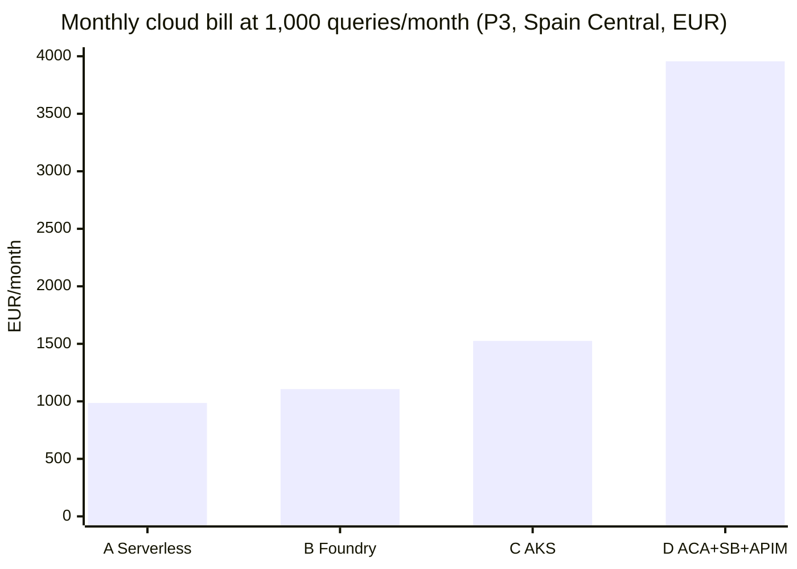
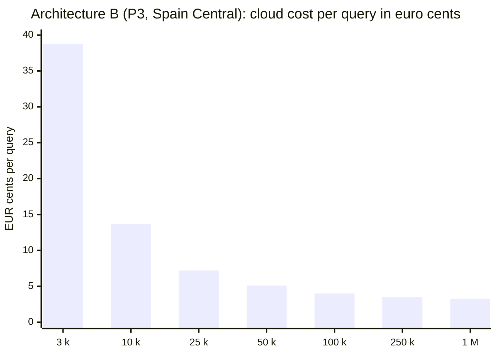
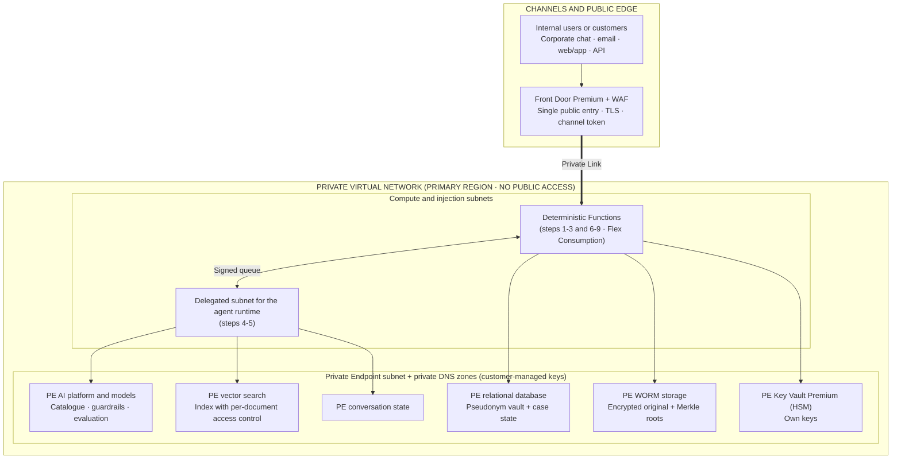
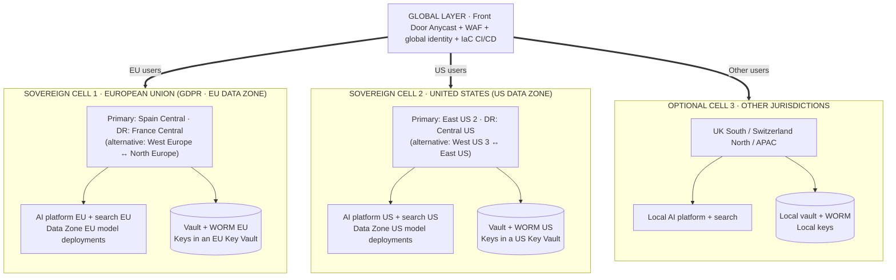
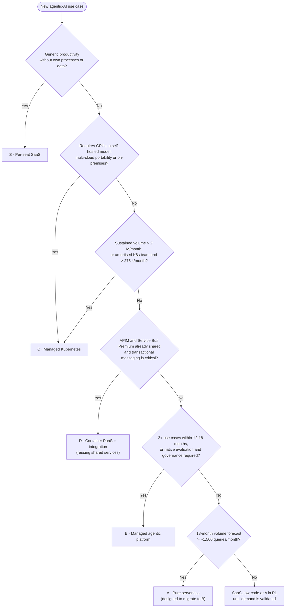

# FinOps Study of Architectures for Enterprise Agentic-AI Platforms

**How to choose between pure serverless, a managed agentic platform, Kubernetes and container PaaS based on volume, organisation size, risk profile, region and budget.**

| Field | Value |
| :--- | :--- |
| Version | 1.0 · November 2026 |
| Scope | Any organisation, industry and size deploying generative-AI assistants or agents with deterministic controls on Microsoft Azure |
| Currency | Every figure in **EUR and USD** (1 EUR = <!-- val:usd-per-eur -->1.15<!-- /val --> USD, configurable) |
| Regions | Calibrated on **Spain Central**; indexed for the main European regions and the major US regions (section 13) |
| Source of figures | Reproducible parametric model in [`calculator/`](../calculator/). Every marked table is regenerated with `python calculator/finops_calculator.py --update-docs` |
| Generated with | Google Antigravity — **Claude Opus 5.5 (High)** (study, parametric FinOps model, Python calculator & Mermaid diagrams) |
| Status | Reference document. Figures are estimates: validate them with the [Azure Pricing Calculator](https://azure.microsoft.com/pricing/calculator/) and your contract prices |

> [!IMPORTANT]
> This study does not crown a universal "winning" architecture. It shows **from which volume, number of use cases, security profile, region and team capabilities** each option makes sense, and it ships the model so you can recompute everything with your own data.

## Table of contents

- [0. Using this study in five minutes](#0-using-this-study-in-five-minutes)
- [1. Executive summary](#1-executive-summary)
- [2. Reference functional pattern](#2-reference-functional-pattern)
- [3. The four candidate architectures and the SaaS benchmark](#3-the-four-candidate-architectures-and-the-saas-benchmark)
- [4. FinOps cost model](#4-finops-cost-model)
  - [4.1 Monthly cost equation](#41-monthly-cost-equation)
  - [4.2 Three thresholds that drive the decision](#42-three-thresholds-that-drive-the-decision)
- [5. The low-volume pilot paradox](#5-the-low-volume-pilot-paradox)
- [6. Cost by volume: the full matrix](#6-cost-by-volume-the-full-matrix)
- [7. Security profiles and efficiency thresholds](#7-security-profiles-and-efficiency-thresholds)
- [8. Crossovers between architectures and the effect of the number of agents](#8-crossovers-between-architectures-and-the-effect-of-the-number-of-agents)
  - [8.1 Crossover volumes (P3, one agent)](#81-crossover-volumes-p3-one-agent)
  - [8.2 The number of use cases decides between A and B](#82-the-number-of-use-cases-decides-between-a-and-b)
  - [8.3 The labour market shifts the thresholds](#83-the-labour-market-shifts-the-thresholds)
- [9. Sensitivity to query type and AI spend optimisation](#9-sensitivity-to-query-type-and-ai-spend-optimisation)
  - [9.1 When does a self-hosted small model pay off?](#91-when-does-a-self-hosted-small-model-pay-off)
  - [9.2 Provisioned capacity vs. pay-per-token](#92-provisioned-capacity-vs-pay-per-token)
- [10. Guidance by organisation size and comparison with SaaS](#10-guidance-by-organisation-size-and-comparison-with-saas)
  - [10.1 Indicative scenarios by segment](#101-indicative-scenarios-by-segment)
  - [10.2 Own platform vs. per-seat SaaS licences](#102-own-platform-vs-per-seat-saas-licences)
- [11. Business case, ROI and value levers](#11-business-case-roi-and-value-levers)
  - [11.1 Value model](#111-value-model)
  - [11.2 Value roadmap: build the foundation once, amortise it across N use cases](#112-value-roadmap-build-the-foundation-once-amortise-it-across-n-use-cases)
  - [11.3 Levers to improve TCO and ROI](#113-levers-to-improve-tco-and-roi)
- [12. DEV/PRE/PRO parity and network topology](#12-devprepro-parity-and-network-topology)
  - [12.1 Reference breakdown in P3 (1,000 queries/month, Spain Central)](#121-reference-breakdown-in-p3-1000-queriesmonth-spain-central)
  - [12.2 Private network topology](#122-private-network-topology)
- [13. Regional analysis: Europe and the United States](#13-regional-analysis-europe-and-the-united-states)
  - [13.1 Regional price index](#131-regional-price-index)
  - [13.2 Representative scenarios by region (cloud bill only)](#132-representative-scenarios-by-region-cloud-bill-only)
  - [13.3 How to choose the primary region](#133-how-to-choose-the-primary-region)
    - [Europe](#europe)
    - [United States](#united-states)
  - [13.4 What changes and what does not](#134-what-changes-and-what-does-not)
- [14. Multi-region scaling and data sovereignty](#14-multi-region-scaling-and-data-sovereignty)
- [15. Decision framework: when to use each option](#15-decision-framework-when-to-use-each-option)
  - [15.1 Decision tree](#151-decision-tree)
  - [15.2 When to use it and when not to](#152-when-to-use-it-and-when-not-to)
  - [15.3 Non-economic criteria that can reverse the decision](#153-non-economic-criteria-that-can-reverse-the-decision)
- [16. Operational FinOps practices for agentic AI](#16-operational-finops-practices-for-agentic-ai)
  - [16.1 Inform (visibility and allocation)](#161-inform-visibility-and-allocation)
  - [16.2 Optimize (unit economics)](#162-optimize-unit-economics)
  - [16.3 Operate (continuous control)](#163-operate-continuous-control)
- [17. Common cost anti-patterns](#17-common-cost-anti-patterns)
- [18. Methodology, assumptions and limitations](#18-methodology-assumptions-and-limitations)
- [19. References](#19-references)

---

## 0. Using this study in five minutes

1. **Estimate your monthly production volume** (queries or conversations resolved per month) at 6 and 18 months, not only the pilot volume.
2. **Classify your risk profile** (section 7): P1 Essential, P2 Standard or P3 Regulated.
3. **Count how many use cases or agents** you expect to run on the same foundation within 12–18 months.
4. **Pick your primary region** (section 13) and decide whether you need DR or additional sovereign cells (section 14).
5. **List assets already paid for**: a Kubernetes platform team, corporate API Management or Service Bus, Front Door/WAF, SIEM.
6. Take that data to the [decision tree](#15-decision-framework-when-to-use-each-option) or run the calculator:

```bash
python calculator/finops_calculator.py --queries 25000 --profile P2 --agents 3 --region westeurope
python calculator/finops_calculator.py --queries 400000 --profile P3 --agents 6 --region eastus2 --k8s-team
python calculator/finops_calculator.py --list-regions
```

---

## 1. Executive summary

1. **Below roughly 5,000 queries/month, the architecture is an "infrastructure tax".** In the regulated profile, 97–99% of the bill for a 1,000-query/month pilot is fixed cost; AI accounts for only 1–3%. At that stage the FinOps goal is not to optimise tokens but to **minimise fixed cost** and **add use cases** on the same foundation.
2. **Container PaaS with enterprise integration (D) is the most expensive way to start**: its fixed cost is 3.6–4 times that of the serverless options because of Service Bus Premium and API Management Standard v2. It is only justified when those services already exist as a shared corporate platform or when transactional messaging is a business requirement.
3. **Pure serverless (A) is the cheapest option with one or two simple agents**, at any volume. From **three use cases** onwards, the **managed agentic platform (B)** delivers a lower TCO because evaluation, guardrails, model catalogue and agent runtime are native and do not have to be built and maintained per agent.
4. **Kubernetes (C) is rarely justified on cost alone**: on the cloud bill it crosses B at about <!-- val:bc-cloud -->191 k<!-- /val --> queries/month, but once operations and build are included the crossover rises to <!-- val:bc-tco -->2.0 M<!-- /val -->. With an existing, amortised Kubernetes platform team it falls to <!-- val:bc-tco-team -->275 k<!-- /val -->. Its real justification is non-economic: GPUs, self-hosted models, multi-cloud portability or on-premises sovereignty.
5. **Above ~250,000 queries/month the architecture stops being the main lever**: AI represents 60–96% of the bill and the decisive factors are the **model mix, routing and caching** (45–65% savings on AI spend).
6. **Region matters, but less than architecture.** With the indicative price indices used here, the major US regions are about <!-- val:us-vs-es-pct -->13<!-- /val -->% cheaper than Spain Central on infrastructure (a B pilot costs <!-- val:b-pilot-us -->€966 / $1,111<!-- /val --> in East US 2 vs. <!-- val:b-pilot-es -->€1,107 / $1,273<!-- /val --> in Spain Central), the Nordic and Irish regions are slightly cheaper than the rest of the EU, and Switzerland is the most expensive. At high volume the gap shrinks because token prices are not region-indexed.
7. **ROI depends more on adoption than on technology.** With conservative assumptions (realised value of <!-- val:value-per-query -->€1.63 / $1.88<!-- /val --> per query), a single-use-case pilot does not recover its investment; with three use cases payback falls below one year, and with six or more, to a few months.
8. **Against per-seat SaaS licences**, an own platform is cheaper from about <!-- val:saas-breakeven-p1 -->88<!-- /val --> users in the essential profile and about <!-- val:saas-breakeven-p3 -->251<!-- /val --> in the regulated profile, **provided the use case is specific** (own processes, own data, deterministic controls). For generic office productivity, SaaS remains the benchmark.
9. **Environment parity without breaking the bank**: with serverless and pay-per-use components, DEV, PRE and PRO can be structurally identical (private networking included) for a fixed cost of roughly €1,000–1,100 / $1,150–1,270 per month in the regulated profile.

---

## 2. Reference functional pattern

The study compares architectures that implement the same pattern: an assistant or agent that **receives a request, pseudonymises it, reasons with AI over corporate knowledge, and only acts after passing deterministic checks**. The pattern strictly separates what AI does (zone 2) from what fixed, auditable rules do (zones 1, 3 and 4).

```mermaid
flowchart LR
    subgraph Z1["ZONE 1 · LISTEN AND FILTER (NO AI)"]
        direction TB
        P1["1. Ingress<br/>Masks sensitive data, encrypts the original"]
        P2["2. Trust and provenance<br/>Corporate identity → pseudonym usr_7K2"]
        P3["3. Admission<br/>Classifies and blocks prompt injection"]
        P1 --> P2 --> P3
    end

    subgraph Z2["ZONE 2 · COGNITIVE PLANE (AI)"]
        direction TB
        P4["4. Perception<br/>Intent + access-controlled retrieval"]
        P5["5. Proposer agent<br/>Draft with citations via model router"]
        ST[("Conversation state<br/>encrypted with own key")]
        P4 --> P5
        P5 <--> ST
    end

    subgraph Z3["ZONE 3 · VERIFY AND AUTHORISE (NO AI)"]
        direction TB
        P6["6. Deterministic verifier<br/>Checks citations, validity and figures"]
        P7["7. Certainty rule<br/>Rule-based threshold or human escalation"]
        P8["8. Action control<br/>Single-use permit (hash)"]
        P6 --> P7 --> P8
    end

    subgraph Z4["ZONE 4 · ACT AND SEAL (NO AI)"]
        direction TB
        P9["9. Egress<br/>Re-identifies and sends exactly once"]
        MK["Audit sealing<br/>Merkle tree + signature on WORM storage"]
        P9 --> MK
    end

    VAULT[("Pseudonym vault<br/>usr_7K2 ↔ person")]
    GOV["Governance plane<br/>Credentials, evaluation, kill switch"]

    P3 ==>|"Pseudonymised text"| P4
    P5 ==>|"Draft with citations"| P6
    P8 ==>|"Single-use token"| P9
    P2 -.->|"Writes mapping"| VAULT
    VAULT -.->|"Reads recipient with token"| P9
    GOV -.-> Z1 & Z2 & Z3 & Z4
```



The pattern applies to internal assistants (IT support, HR, procurement, legal, operations), customer-facing assistants (customer service, self-service, after-sales) and agents that execute actions in transactional systems. **What changes between organisations is the volume, the number of use cases and the level of control required**, which is exactly what the model parameterises.

---

## 3. The four candidate architectures and the SaaS benchmark

| Option | Technology stack | Where AI runs (steps 4–5) | Where deterministic barriers run | Main strength | Main weakness |
| :--- | :--- | :--- | :--- | :--- | :--- |
| **A · Pure serverless** | Azure Functions Flex Consumption + Durable Functions + queues | Own code calling models | Functions | Lowest fixed cost, scales to zero | Evaluation, guardrails and multi-agent orchestration must be built and maintained |
| **B · Managed agentic platform** | Microsoft Foundry (Agent Service, Model Router, Evaluations, Guardrails) + Functions | Managed agent runtime injected into the private network | Functions | Near-zero marginal cost per new agent; native governance | Higher provider dependency; slightly higher fixed cost than A |
| **C · Managed Kubernetes** | AKS Automatic + Gateway API + Kafka/Event Hubs + operators | Own containers (or self-hosted model on GPU) | Containers | Maximum control, portability, GPUs, lowest platform variable cost | Requires an SRE/platform team; high human fixed cost |
| **D · Container PaaS with enterprise integration** | Azure Container Apps + Service Bus Premium + API Management Standard v2 | Own containers | Containers + messaging | Mature enterprise integration patterns (sessions, transactions, API policies) | Very high fixed cost per environment unless services are shared |
| **S · Per-seat SaaS (benchmark)** | Commercial assistant licensed per user | Vendor | Limited to what the product offers | Zero build, immediate adoption | Cost grows linearly with users; little deterministic control over own processes |

> [!NOTE]
> All four options share the same data services (vector search, relational database for the vault, WORM storage, key management, observability). What differentiates them is **the compute, orchestration and integration plane**, which is where the fixed-cost difference concentrates.

---

## 4. FinOps cost model

### 4.1 Monthly cost equation

$$
\text{TCO}(Q) = \underbrace{F_{arch,profile} \cdot I_{region} \cdot M_{regions}}_{\text{cloud fixed}} + \underbrace{Q \cdot \left(v_{AI} \cdot k_{deploy} \cdot (1-\text{saving}) + v_{platform} \cdot I_{region}\right)}_{\text{cloud variable}} + E(Q) + \underbrace{\text{FTE}_{arch}(n) \cdot c_{FTE}}_{\text{operations}} + \frac{C_{build}}{\text{months}}
$$

| Term | Meaning | Default value |
| :--- | :--- | :--- |
| `Q` | Queries resolved per month in production | Input |
| `F` | Fixed cloud cost across all environments (DEV/PRE/PRO) for the architecture and security profile | Section 7 |
| `I_region` | Infrastructure price index of the region (Spain Central = 1.00) | Section 13 |
| `M` | Multiplier for DR regions or additional sovereign cells | 1 region = 1.0 |
| `v_AI` | AI cost per query: tokens + content safety + PII detection + embeddings | €0.004 (light) · €0.026 (standard) · €0.12 (agentic) |
| `k_deploy` | Model deployment type factor: Global, Data Zone (EU/US) or Regional | 0.91 · 1.00 · 1.05 |
| `saving` | Reduction from model routing and semantic caching | 0% · 45% · 65% |
| `v_platform` | Variable compute, queue, state and trace cost per query | €0.0008 (C) – €0.003 (B) |
| `E(Q)` | Capacity steps (search tiers, database, observability) | +€350 from 250 k · +€1,200 from 1 M · +€4,500 from 5 M |
| `FTE(n)` | Platform operations effort, growing with the number of agents `n` | 0.20 (A) · 0.22 (B) · 0.60 (C) · 0.30 (D) + per-agent increment |
| `c_FTE` | Fully loaded monthly cost of one FTE | €6,500 / $7,475 |
| `C_build` | Initial build investment, amortised | €30 k (P1) · €80 k (P2) · €160 k (P3) × architecture factor, over 36 months |

### 4.2 Three thresholds that drive the decision

- **Unit-efficiency threshold** `Q* = F / v`: volume above which variable cost exceeds fixed cost. Below it you pay for infrastructure; above it you pay for AI.
- **Crossover volume** between architectures X and Y: `Q = (F_Y − F_X) / (v_X − v_Y)`. Below it the lower-fixed-cost option wins; above it, the lower-variable-cost option.
- **Value (ROI) break-even**: volume at which realised value covers the full TCO: `Q = (F + operations + amortisation) / (value per query − v)`.

> [!TIP]
> The capacity steps `E(Q)` are common to all four architectures, so they do not change crossover volumes; they do affect absolute unit cost at high volume.

---

## 5. The low-volume pilot paradox

A typical pilot handles 1,000–3,000 queries per month (33–100 per day). At that volume any high-security architecture (private networking, HSM, immutable storage, three isolated environments) produces a unit cost that looks disproportionate, because **almost everything is fixed cost**. The table shows the reference scenario (P3 Regulated profile, standard query, Spain Central, cloud bill only):

<!-- BEGIN:table-reference -->
| KPI (P3 Regulated, standard query, Spain Central) | A · Serverless (Functions) | B · Foundry + Functions | C · AKS Automatic | D · ACA + SB Premium + APIM |
| :--- | ---: | ---: | ---: | ---: |
| Monthly cloud bill @ 1,000 queries/month | €986 / $1,133 | €1,107 / $1,273 | €1,525 / $1,754 | €3,956 / $4,549 |
| Cost per query @ 1,000 queries/month | €0.986 / $1.13 | €1.11 / $1.27 | €1.52 / $1.75 | €3.96 / $4.55 |
| Fixed-cost share @ 1,000 queries/month | 97.1% | 97.4% | 98.2% | 99.3% |
| Monthly cloud bill @ 25,000 queries/month | €1,670 / $1,920 | €1,803 / $2,073 | €2,168 / $2,493 | €4,616 / $5,308 |
| Cost per query @ 25,000 queries/month | €0.0668 / $0.0768 | €0.0721 / $0.0829 | €0.0867 / $0.0997 | €0.185 / $0.212 |
| Annual saving vs. D @ 1,000 queries/month | €35,640 / $40,986 (−75.1%) | €34,182 / $39,309 (−72.0%) | €29,168 / $33,544 (−61.5%) | Baseline |
| Estimated operations effort (FTE, 1 agent) | 0.20 | 0.22 | 0.60 | 0.30 |
| Governance, CI/CD evaluation, multi-agent | Custom code | Native and unified | Self-managed on K8s | Manual + APIM |
<!-- END:table-reference -->

<!-- BEGIN:chart-pilot -->

<!-- END:chart-pilot -->

**FinOps reading:**

- At 1,000 queries/month, **D costs almost €4 / $4.5 per query** and 99% of it is infrastructure. At that volume the operational ROI is negative compared with answering the query manually.
- **A and B cut the entry toll by 72–75%**, which makes a pilot viable without burning budget, but **no architecture turns a pilot into a profitable business**: return requires scaling to tens of thousands of queries per month by adding use cases.
- If your 18-month volume forecast does not exceed a few thousand queries per month, **lower the security profile** (if risk allows) or consider **SaaS/low-code** before an own platform (section 10).

---

## 6. Cost by volume: the full matrix

Monthly cloud bill and cost per query (P3, standard query, Spain Central, no AI optimisation). In bold, the cheapest cloud bill for each volume:

<!-- BEGIN:table-volume-matrix -->
| Queries/month | A · Serverless (Functions) | B · Foundry + Functions | C · AKS Automatic | D · ACA + SB Premium + APIM |
| :--- | ---: | ---: | ---: | ---: |
| 1 k | **€986 / $1,133<br>€0.986 / $1.13 per query** | €1,107 / $1,273<br>€1.11 / $1.27 per query | €1,525 / $1,754<br>€1.52 / $1.75 per query | €3,956 / $4,549<br>€3.96 / $4.55 per query |
| 3 k | **€1,042 / $1,199<br>€0.347 / $0.400 per query** | €1,165 / $1,340<br>€0.388 / $0.447 per query | €1,578 / $1,815<br>€0.526 / $0.605 per query | €4,010 / $4,612<br>€1.34 / $1.54 per query |
| 10 k | **€1,242 / $1,428<br>€0.124 / $0.143 per query** | €1,368 / $1,573<br>€0.137 / $0.157 per query | €1,766 / $2,031<br>€0.177 / $0.203 per query | €4,203 / $4,833<br>€0.420 / $0.483 per query |
| 25 k | **€1,670 / $1,920<br>€0.0668 / $0.0768 per query** | €1,803 / $2,073<br>€0.0721 / $0.0829 per query | €2,168 / $2,493<br>€0.0867 / $0.0997 per query | €4,616 / $5,308<br>€0.185 / $0.212 per query |
| 50 k | **€2,382 / $2,739<br>€0.0476 / $0.0548 per query** | €2,528 / $2,907<br>€0.0506 / $0.0581 per query | €2,838 / $3,264<br>€0.0568 / $0.0653 per query | €5,303 / $6,098<br>€0.106 / $0.122 per query |
| 100 k | **€3,807 / $4,378<br>€0.0381 / $0.0438 per query** | €3,978 / $4,575<br>€0.0398 / $0.0457 per query | €4,178 / $4,805<br>€0.0418 / $0.0480 per query | €6,678 / $7,680<br>€0.0668 / $0.0768 per query |
| 250 k | **€8,432 / $9,697<br>€0.0337 / $0.0388 per query** | €8,678 / $9,980<br>€0.0347 / $0.0399 per query | €8,548 / $9,830<br>€0.0342 / $0.0393 per query | €11,153 / $12,826<br>€0.0446 / $0.0513 per query |
| 1 M | €31,007 / $35,658<br>€0.0310 / $0.0357 per query | €31,628 / $36,372<br>€0.0316 / $0.0364 per query | **€29,848 / $34,325<br>€0.0298 / $0.0343 per query** | €32,978 / $37,925<br>€0.0330 / $0.0379 per query |
| 5 M | €149,507 / $171,933<br>€0.0299 / $0.0344 per query | €152,128 / $174,947<br>€0.0304 / $0.0350 per query | **€141,548 / $162,780<br>€0.0283 / $0.0326 per query** | €147,478 / $169,600<br>€0.0295 / $0.0339 per query |
<!-- END:table-volume-matrix -->

<!-- BEGIN:chart-unit-cost -->

<!-- END:chart-unit-cost -->

**FinOps reading:**

- **Up to ~250,000 queries/month**, the lowest fixed cost (A, closely followed by B) wins on the cloud bill.
- **From ~1 M queries/month**, C becomes the cheapest on the cloud bill thanks to its lower platform variable cost, but the difference is 3–7%, usually smaller than the extra human cost of running Kubernetes (section 8).
- **D only converges with the others at very high volume**: its fixed-cost premium is diluted but never disappears.
- **Unit cost converges towards the cost of AI** (~€0.03 / $0.035 per unoptimised standard query). Below that floor, the only relevant lever is reducing `v_AI` (section 9).

---

## 7. Security profiles and efficiency thresholds

After volume, the level of control required is the factor that moves fixed cost the most. The study defines three profiles:

| Profile | Environments | Network | Keys and audit | AI deployment (default) | When it applies |
| :--- | :--- | :--- | :--- | :--- | :--- |
| **P1 · Essential** | DEV + PRO | Public endpoints with corporate identity and basic WAF | Key Vault Standard, no WORM | Global | Internal non-sensitive data, proofs of value, small organisations |
| **P2 · Standard** | DEV + PRE + PRO | Private networking and Private Endpoints in PRO only | Key Vault Standard, standard retention | Data Zone (EU/US) | Low-risk personal data, most internal use cases |
| **P3 · Regulated** | DEV + PRE + PRO with full parity | Private networking in all three environments, no public access | HSM, customer-managed keys, WORM, audit sealing | Data Zone (EU/US) | Personal or regulated data, supervised industries, decisions affecting people |

Monthly fixed cost (all environments, Spain Central) and unit-efficiency threshold (queries/month above which variable cost exceeds fixed cost, standard query):

<!-- BEGIN:table-profiles -->
| Architecture | Fixed P1 Essential | Fixed P2 Standard | Fixed P3 Regulated | Efficiency threshold P1 | Efficiency threshold P2 | Efficiency threshold P3 |
| :--- | ---: | ---: | ---: | ---: | ---: | ---: |
| A · Serverless (Functions) | €140 / $161 | €520 / $598 | €957 / $1,101 | 5,400 | 18,200 | 33,600 |
| B · Foundry + Functions | €165 / $190 | €580 / $667 | €1,078 / $1,240 | 6,200 | 20 k | 37,200 |
| C · AKS Automatic | €620 / $713 | €1,050 / $1,208 | €1,498 / $1,723 | 25,300 | 39,200 | 55,900 |
| D · ACA + SB Premium + APIM | €430 / $494 | €2,150 / $2,472 | €3,928 / $4,517 | 17,100 | 78,200 | 142,800 |
<!-- END:table-profiles -->

> [!WARNING]
> Choosing P3 "just in case" for a use case with non-sensitive data multiplies fixed cost by 6–9 compared with P1. Choosing P1 for regulated data can cost far more in fines and loss of trust. **The profile is decided by the risk of the data and of the action, not by the architecture.**

---

## 8. Crossovers between architectures and the effect of the number of agents

### 8.1 Crossover volumes (P3, one agent)

<!-- BEGIN:table-crossovers -->
| Pair | Crossover, cloud bill only | Crossover, TCO (cloud + operations + build) | Crossover, TCO with an amortised K8s team | Crossover, TCO with shared corporate APIM/Service Bus |
| :--- | ---: | ---: | ---: | ---: |
| A ↔ B | Always A | Always A | — | — |
| B ↔ C | 191 k | 2.0 M | 275 k | — |
| A ↔ C | 318 k | 3.0 M | 765 k | — |
| B ↔ D | 1.9 M | 2.7 M | — | 1.4 M |
| C ↔ D | Always C | 584 k | Always C | 3.3 M |
<!-- END:table-crossovers -->

How to read it: "Always X" means X is cheaper across the whole volume range; a number is the monthly volume above which the second option of the pair becomes cheaper.

- **A ↔ B**: with a single agent, A is always cheaper; the crossover is triggered by the **number of agents**, not by volume (8.2).
- **B ↔ C**: Kubernetes only pays off on cost at millions of queries, unless the Kubernetes team and platform already exist and are amortised.
- **B ↔ D and C ↔ D**: sharing corporate API Management and Service Bus brings D closer, but does not make it the cheapest option for a new use case.

### 8.2 The number of use cases decides between A and B

Monthly TCO (cloud + operations + amortised build) at 10,000 queries/month in profile P2, by number of agents deployed on the same foundation:

<!-- BEGIN:table-agents -->
| Agents / use cases | TCO A · Serverless (Functions) | TCO B · Foundry + Functions | TCO C · AKS Automatic | TCO D · ACA + SB Premium + APIM |
| :--- | ---: | ---: | ---: | ---: |
| 1 | **€4,105 / $4,721** | €4,522 / $5,201 | €8,218 / $9,451 | €6,931 / $7,970 |
| 2 | **€4,698 / $5,403** | €4,726 / $5,435 | €8,626 / $9,920 | €7,403 / $8,514 |
| 3 | €5,292 / $6,085 | **€4,930 / $5,670** | €9,034 / $10,389 | €7,876 / $9,058 |
| 4 | €5,885 / $6,768 | **€5,134 / $5,904** | €9,441 / $10,858 | €8,349 / $9,601 |
| 6 | €7,072 / $8,132 | **€5,542 / $6,373** | €10,257 / $11,795 | €9,294 / $10,689 |
| 8 | €8,258 / $9,497 | **€5,949 / $6,842** | €11,072 / $12,733 | €10,240 / $11,776 |
| 12 | €10,632 / $12,226 | **€6,765 / $7,780** | €12,704 / $14,609 | €12,131 / $13,951 |
<!-- END:table-agents -->

**Rule of thumb:** with **one or two simple agents**, A; with **three or more**, B. Each additional agent on A requires custom orchestration, evaluation and guardrail code; on B it reuses the runtime, continuous evaluation and model catalogue already deployed, with practically no extra infrastructure fixed cost.

### 8.3 The labour market shifts the thresholds

The loaded cost of engineers varies widely between European countries and the US. The higher it is, the stronger the case for managed services:

<!-- BEGIN:table-fte-sensitivity -->
| Labour market | Loaded FTE cost/month | B beats A from (P2, 10 k queries) | B ↔ C TCO crossover (P3) | B ↔ C with amortised K8s team |
| :--- | ---: | ---: | ---: | ---: |
| Southern / Eastern Europe | €4,500 / $5,175 | 3 agents | 1.7 M | 311 k |
| Model default | €6,500 / $7,475 | 3 agents | 2.0 M | 275 k |
| Northern / Western Europe | €9,000 / $10,350 | 3 agents | 2.5 M | 229 k |
| United States | €11,500 / $13,225 | 2 agents | 2.9 M | 184 k |
<!-- END:table-fte-sensitivity -->

> [!TIP]
> Design A so it can migrate to B: keep the deterministic barriers (steps 1–3 and 6–9) in Functions in both cases. Moving from A to B then only replaces steps 4–5, and the switching cost is low.

---

## 9. Sensitivity to query type and AI spend optimisation

Not all queries cost the same. The table shows architecture B (P3, Spain Central) with three query profiles, with and without model routing (small models for simple queries, frontier models only when needed) and semantic caching:

<!-- BEGIN:table-query-profiles -->
| Query profile | AI optimisation | AI cost / query | B cost / query @ 25 k | B cost / query @ 1 M | B monthly bill @ 1 M | AI share @ 1 M |
| :--- | ---: | ---: | ---: | ---: | ---: | ---: |
| FAQ / light RAG | Not optimised | €0.0040 / $0.0046 | €0.0501 / $0.0576 | €0.0096 / $0.0111 | €9,628 / $11,072 | 42% |
| FAQ / light RAG | Model router + semantic cache | €0.0014 / $0.0016 | €0.0475 / $0.0546 | €0.0070 / $0.0081 | €7,028 / $8,082 | 20% |
| RAG with verification | Not optimised | €0.0260 / $0.0299 | €0.0721 / $0.0829 | €0.0316 / $0.0364 | €31,628 / $36,372 | 82% |
| RAG with verification | Model router + semantic cache | €0.0091 / $0.0105 | €0.0552 / $0.0635 | €0.0147 / $0.0169 | €14,728 / $16,937 | 62% |
| Multi-step agentic | Not optimised | €0.120 / $0.138 | €0.166 / $0.191 | €0.126 / $0.144 | €125,628 / $144,472 | 96% |
| Multi-step agentic | Model router + semantic cache | €0.0420 / $0.0483 | €0.0881 / $0.101 | €0.0476 / $0.0548 | €47,628 / $54,772 | 88% |
<!-- END:table-query-profiles -->

**FinOps reading:**

- **At low volume (25 k/month) optimising tokens barely moves unit cost**: fixed cost dominates.
- **At high volume (1 M/month) AI is 60–96% of the bill**, and routing + caching cuts the total bill by 25–60%.
- **Multi-step agentic workloads** can cost 5–15 times more per query than light RAG. Budget per interaction type, not per "average query".

### 9.1 When does a self-hosted small model pay off?

Self-hosting a small model on GPUs (typically on C) has a high fixed cost and a per-query saving versus the pay-per-use API. With the default assumptions (two GPU nodes for high availability ≈ €2,200 / $2,530 per month and a saving of €0.004 per query routed to the local model), break-even is around **<!-- val:slm-breakeven -->550 k<!-- /val --> queries/month** routable to that model, before counting the effort of operating inference.

### 9.2 Provisioned capacity vs. pay-per-token

Reserved model capacity (provisioned throughput units) only pays off with **sustained high utilisation** (as a guide, above 60–70% continuously) or when guaranteed latency is a requirement. Compute `reserved_cost / (tokens_per_month × price_per_token)` with your real traffic profile: the daytime peaks and night-time troughs typical of internal assistants usually favour pay-per-use.

---

## 10. Guidance by organisation size and comparison with SaaS

### 10.1 Indicative scenarios by segment

<!-- BEGIN:table-segments -->
| Segment | Users | Queries/month | Profile · agents | Lowest TCO (model) | Cloud/month | Cloud/query | TCO/month | Equivalent per-seat SaaS | Economic verdict |
| :--- | ---: | ---: | ---: | ---: | ---: | ---: | ---: | ---: | ---: |
| XS · Start-up / micro | < 50 | 1 k | P1 · 1 agent | A · Serverless (Functions) | €166 / $191 | €0.166 / $0.191 | €2,216 / $2,549 | €840 / $966 (30 users) | SaaS / low-code |
| S · Small business | 50 – 250 | 5 k | P1 · 2 agents | B · Foundry + Functions | €298 / $343 | €0.0597 / $0.0686 | €2,766 / $3,180 | €4,200 / $4,830 (150 users) | Own platform |
| M · Mid-size company | 250 – 2,000 | 25 k | P2 · 3 agents | B · Foundry + Functions | €1,305 / $1,501 | €0.0522 / $0.0600 | €5,365 / $6,170 | €28,000 / $32,200 (1,000 users) | Own platform |
| L · Large enterprise | 2,000 – 20,000 | 120 k | P3 · 6 agents | B · Foundry + Functions | €4,558 / $5,242 | €0.0380 / $0.0437 | €11,452 / $13,170 | €224,000 / $257,600 (8,000 users) | Own platform |
| XL · Global corporation / B2C app | > 20,000 | 1.5 M | P3 · 10 agents · 3 regions | B · Foundry + Functions | €47,616 / $54,758 | €0.0317 / $0.0365 | €55,975 / $64,371 | €1,400,000 / $1,610,000 (50,000 users) | Own platform |
<!-- END:table-segments -->

> [!NOTE]
> The verdict compares the platform TCO with licensing a SaaS assistant to the segment's representative users. Segments are indicative: a small business with a customer-facing app can have the volume of a large enterprise, and a large enterprise can start with a single low-volume use case. **Use volume and risk profile, not headcount, as decision variables.**

**By segment:**

- **XS (start-up/micro):** human and build costs dominate. Start with SaaS, low-code or A in P1; reassess when you exceed a few thousand queries/month or need your own controls.
- **S (small business):** A or B in P1/P2. If you expect 3+ use cases, starting with B avoids a migration.
- **M (mid-size):** B in P2 is the usual sweet spot; P3 only for use cases with regulated data.
- **L (large enterprise):** B in P3 as the corporate "agentic landing zone"; reuse corporate Front Door/WAF, SIEM and network (section 11.3).
- **XL (global / B2C):** B or C depending on whether a Kubernetes team and GPU requirements exist; the main lever is AI optimisation (section 9) and regional topology (sections 13–14).

### 10.2 Own platform vs. per-seat SaaS licences

TCO of platform B (two use cases, ten queries per user per month) versus licensing a SaaS assistant at €28 / $32 per user per month:

<!-- BEGIN:table-saas -->
| Users | Queries/month | Profile | Per-seat SaaS/month | Platform B TCO/month | Cheaper |
| ---: | ---: | :---: | ---: | ---: | :---: |
| 25 | 250 | P1 | €700 / $805 | €2,639 / $3,035 | SaaS |
| 50 | 500 | P1 | €1,400 / $1,610 | €2,646 / $3,042 | SaaS |
| 100 | 1 k | P1 | €2,800 / $3,220 | €2,659 / $3,058 | Platform |
| 250 | 2,500 | P2 | €7,000 / $8,050 | €4,509 / $5,185 | Platform |
| 1,000 | 10 k | P2 | €28,000 / $32,200 | €4,726 / $5,435 | Platform |
| 5,000 | 50 k | P3 | €140,000 / $161,000 | €8,606 / $9,897 | Platform |
| 20,000 | 200 k | P3 | €560,000 / $644,000 | €12,956 / $14,900 | Platform |
<!-- END:table-saas -->

> [!WARNING]
> **This is not a comparison of equivalent products.** An office-suite SaaS assistant provides general productivity (drafting, summaries, meetings) that an own platform does not replicate; an own platform provides specific processes, own data, deterministic verification and traceability that SaaS does not offer. The comparison holds when both solve **the same use case**. Many organisations combine both: SaaS for personal productivity, own platform for business processes.

---

## 11. Business case, ROI and value levers

### 11.1 Value model

The value of an automatically resolved query is estimated as:

$$
\text{value per query} = \frac{\text{minutes saved}}{60} \times \text{loaded hourly cost} \times \text{automation rate} \times \text{realisation rate}
$$

With the default assumptions (8 combined minutes between requester and responder, €35 / $40 loaded per hour, 70% automation and **only 50% of savings turned into "hard" savings**), the realised value is **<!-- val:value-per-query -->€1.63 / $1.88<!-- /val --> per incoming query**.

> [!IMPORTANT]
> The **realisation rate** separates "soft" savings (time freed) from "hard" savings (avoided cost or capacity redeployed to higher-value work). Presenting only gross savings against the cloud bill, without people and build costs, overstates ROI by 5–10 times.

### 11.2 Value roadmap: build the foundation once, amortise it across N use cases

<!-- BEGIN:table-roadmap -->
| Stage (architecture B, P3) | Queries/month | Cloud/month | Cloud/query | TCO/month | Realised value/month | Net benefit/month (after amortisation) | Value/TCO | Payback of initial investment |
| :--- | ---: | ---: | ---: | ---: | ---: | ---: | ---: | ---: |
| Milestone 1 · Pilot (1 use case) | 3 k | €1,165 / $1,340 | €0.388 / $0.447 | €7,039 / $8,095 | €4,900 / $5,635 | -€2,139 / -$2,460 | 0.7x | 69.4 months |
| Milestone 2 · 3 use cases | 15 k | €1,513 / $1,740 | €0.101 / $0.116 | €7,795 / $8,965 | €24,500 / $28,175 | €16,705 / $19,210 | 3.1x | 7.9 months |
| Milestone 3 · 6 use cases | 45 k | €2,383 / $2,740 | €0.0530 / $0.0609 | €9,277 / $10,668 | €73,500 / $84,525 | €64,223 / $73,857 | 7.9x | 2.7 months |
| Milestone 4 · Company-wide assistant | 120 k | €4,558 / $5,242 | €0.0380 / $0.0437 | €12,267 / $14,108 | €196,000 / $225,400 | €183,733 / $211,292 | 16.0x | 1.1 months |
<!-- END:table-roadmap -->

Minimum monthly volume for realised value to cover full TCO, by architecture and profile, and number of users above which platform B is cheaper than a per-seat SaaS:

<!-- BEGIN:table-breakevens -->
| Profile | ROI break-even A | ROI break-even B | ROI break-even C | ROI break-even D | Break-even vs. SaaS (B) |
| :--- | ---: | ---: | ---: | ---: | ---: |
| P1 | 1,400 | 1,500 | 3,500 | 2,100 | 88 users |
| P2 | 2,400 | 2,600 | 4,900 | 4,100 | 153 users |
| P3 | 3,900 | 4,300 | 7,100 | 6,800 | 251 users |
<!-- END:table-breakevens -->

### 11.3 Levers to improve TCO and ROI

1. **Near-zero marginal cost per new use case (internal multi-tenancy).** On B, a second and third agent reuse the private network, pseudonym vault, verifier and front door with no additional infrastructure fixed cost.
2. **Reuse corporate infrastructure already paid for (shared services).** Connecting the platform to corporate Front Door/WAF, firewall, SIEM or API Management removes up to ~€290 / $334 per month (edge) and ~€1,900 / $2,185 per month (integration, on D) from fixed cost, allocated through showback.
3. **Model routing with small models first.** Automatically routing most simple queries to small models and applying semantic caching cuts AI spend by 45–65%.
4. **Scale non-production environments to zero.** With serverless components, DEV and PRE cost a fraction of PRO without giving up structural parity.
5. **Commitments only where there is a stable baseline.** Reservations or savings plans for the stable part (database, search, cluster nodes) once the load is known, never during the pilot.
6. **Choose the region deliberately.** Within the EU, Sweden Central and North Europe are typically the cheapest; for US workloads, East US 2 and West US 3 (section 13).
7. **Regulatory risk mitigation.** A single personal-data breach or an unaudited automated decision can exceed the annual cost of the entire infrastructure; pseudonymisation, deterministic verification and audit sealing are also a financial lever.

---

## 12. DEV/PRE/PRO parity and network topology

Deploying **three structurally identical environments** with Terraform modules from [Azure Verified Modules](https://azure.github.io/Azure-Verified-Modules/) (for example `Azure/avm-ptn-aiml-ai-foundry/azurerm`, `Azure/avm-res-web-site/azurerm` and `Azure/avm-res-dbforpostgresql-flexibleserver/azurerm`) avoids the classic problem of deploying DEV without private networking "to save money" and discovering private DNS resolution, permission or security-filter errors in production.

### 12.1 Reference breakdown in P3 (1,000 queries/month, Spain Central)

| Component (full private-network parity across the three environments) | DEV | PRE | PRO | Total B | Total D |
| :--- | ---: | ---: | ---: | ---: | ---: |
| **Control plane and AI gateway**: Foundry project (B) / API Management (D) | €0.00 | €0.00 | €0.00 | **€0.00 / $0.00** | €700.51 / $805.59 |
| **AI runtime and state**: Agent Service + Cosmos DB serverless (B) / Container Apps (D) | €1.80 | €4.50 | €18.40 | **€24.70 / $28.41** | €525.02 / $603.77 |
| **Deterministic barriers** (steps 1–3 and 6–9): Functions Flex + queues (B) / Service Bus Premium (D) | €0.90 | €5.20 | €34.20 | **€40.30 / $46.35** | €1,200.27 / $1,380.31 |
| **Single public entry point**: Front Door Premium + WAF (DEV/PRE/PRO routes) | shared | shared | €290.49 | **€290.49 / $334.06** | €290.49 / $334.06 |
| **Pseudonym vault and case state**: PostgreSQL Flexible (B1ms / B2s / B2s HA) | €12.40 | €27.50 | €112.00 | **€151.90 / $174.69** | €351.74 / $404.50 |
| **Vector knowledge**: Azure AI Search Basic (PRO with 2 replicas) | €64.90 | €64.90 | €129.79 | **€259.59 / $298.53** | €259.59 / $298.53 |
| **Identical private network**: Private Endpoints + private DNS + NAT egress | €52.80 | €61.60 | €105.60 | **€220.00 / $253.00** | €405.03 / $465.78 |
| **HSM keys, WORM, protection and traces**: Key Vault Premium, Blob WORM, Monitor | €9.20 | €16.80 | €51.45 | **€77.45 / $89.07** | €184.75 / $212.46 |
| **AI consumption and continuous evaluation**: models, guardrails, CI/CD evaluation | €8.10 | €10.10 | €24.17 | **€42.37 / $48.73** | €38.59 / $44.38 |
| **Monthly total** | **€150.10** | **€190.60** | **€766.10** | **€1,106.80 / $1,272.82** | **€3,955.99 / $4,549.39** |

> [!NOTE]
> The parametric model approximates this breakdown as €1,078 fixed + €0.029 per query (B) and €3,928 fixed + €0.0275 per query (D). PRO concentrates ~69% of B's cost; that is the share replicated when adding regions (section 14).

### 12.2 Private network topology



---

## 13. Regional analysis: Europe and the United States

### 13.1 Regional price index

Azure list prices differ by region. The model applies an **infrastructure price index** (blended across compute, PaaS, networking and storage) to fixed costs, platform variable costs and capacity steps. **Token prices for AI models are not region-indexed**: they depend on the deployment type (Global, Data Zone EU/US, Regional).

<!-- BEGIN:table-region-index -->
| Region | Geography | Infra price index (Spain Central = 1.00) | Paired region / DR option | AI data zone |
| :--- | :--- | ---: | :--- | :--- |
| Spain Central (Madrid) (`spaincentral`) | EU | 1.00 | None (availability zones; cross-region DR to France Central or West Europe) | EU |
| West Europe (Netherlands) (`westeurope`) | EU | 1.00 | North Europe | EU |
| North Europe (Ireland) (`northeurope`) | EU | 0.95 | West Europe | EU |
| France Central (Paris) (`francecentral`) | EU | 1.02 | France South | EU |
| Germany West Central (Frankfurt) (`germanywestcentral`) | EU | 1.04 | Germany North | EU |
| Sweden Central (Gävle) (`swedencentral`) | EU | 0.94 | Sweden South | EU |
| Italy North (Milan) (`italynorth`) | EU | 1.02 | None (availability zones) | EU |
| Poland Central (Warsaw) (`polandcentral`) | EU | 1.00 | None (availability zones) | EU |
| UK South (London) (`uksouth`) | Europe (non-EU) | 1.03 | UK West | Check UK options |
| Switzerland North (Zurich) (`switzerlandnorth`) | Europe (non-EU) | 1.18 | Switzerland West | Check CH options |
| East US (Virginia) (`eastus`) | US | 0.88 | West US | US |
| East US 2 (Virginia) (`eastus2`) | US | 0.87 | Central US | US |
| Central US (Iowa) (`centralus`) | US | 0.90 | East US 2 | US |
| South Central US (Texas) (`southcentralus`) | US | 0.90 | North Central US | US |
| West US 2 (Washington) (`westus2`) | US | 0.90 | West Central US | US |
| West US 3 (Arizona) (`westus3`) | US | 0.88 | East US | US |
<!-- END:table-region-index -->

> [!CAUTION]
> The indices are **indicative assumptions** derived from typical list-price differentials and must be validated with the [Azure Pricing Calculator](https://azure.microsoft.com/pricing/calculator/) for your exact SKUs. Service and model availability also varies by region: confirm Microsoft Foundry Agent Service, the model deployment types you need, Functions Flex Consumption and AKS Automatic in your target region before committing.

### 13.2 Representative scenarios by region (cloud bill only)

<!-- BEGIN:table-region-costs -->
| Region | A · P1 · 5 k queries | B · P3 · 1 k queries (pilot) | B · P2 · 25 k queries | C · P3 · 1 M queries |
| :--- | ---: | ---: | ---: | ---: |
| Spain Central (Madrid) | €271 / $311 | €1,107 / $1,273 | €1,305 / $1,501 | €29,848 / $34,325 |
| West Europe (Netherlands) | €271 / $311 | €1,107 / $1,273 | €1,305 / $1,501 | €29,848 / $34,325 |
| North Europe (Ireland) | €263 / $303 | €1,053 / $1,211 | €1,272 / $1,463 | €29,656 / $34,104 |
| France Central (Paris) | €274 / $315 | €1,129 / $1,298 | €1,318 / $1,516 | €29,925 / $34,414 |
| Germany West Central (Frankfurt) | €277 / $318 | €1,150 / $1,323 | €1,331 / $1,531 | €30,002 / $34,502 |
| Sweden Central (Gävle) | €262 / $301 | €1,042 / $1,198 | €1,266 / $1,456 | €29,617 / $34,060 |
| Italy North (Milan) | €274 / $315 | €1,129 / $1,298 | €1,318 / $1,516 | €29,925 / $34,414 |
| Poland Central (Warsaw) | €271 / $311 | €1,107 / $1,273 | €1,305 / $1,501 | €29,848 / $34,325 |
| UK South (London) | €275 / $317 | €1,139 / $1,310 | €1,325 / $1,523 | €29,963 / $34,458 |
| Switzerland North (Zurich) | €298 / $343 | €1,302 / $1,497 | €1,423 / $1,636 | €30,541 / $35,122 |
| East US (Virginia) | €252 / $290 | €977 / $1,124 | €1,226 / $1,410 | €29,386 / $33,794 |
| East US 2 (Virginia) | €251 / $289 | €966 / $1,111 | €1,220 / $1,403 | €29,348 / $33,750 |
| Central US (Iowa) | €256 / $294 | €999 / $1,149 | €1,240 / $1,425 | €29,463 / $33,883 |
| South Central US (Texas) | €256 / $294 | €999 / $1,149 | €1,240 / $1,425 | €29,463 / $33,883 |
| West US 2 (Washington) | €256 / $294 | €999 / $1,149 | €1,240 / $1,425 | €29,463 / $33,883 |
| West US 3 (Arizona) | €252 / $290 | €977 / $1,124 | €1,226 / $1,410 | €29,386 / $33,794 |
<!-- END:table-region-costs -->

### 13.3 How to choose the primary region

#### Europe

- **Spain Central (Madrid)** — best latency for Iberian users and data at rest in Spain, a common requirement for Spanish public sector, healthcare, banking and regulated contracts. It has **no paired region**: resilience relies on availability zones, and cross-region DR is usually placed in **France Central** or **West Europe**, both inside the EU Data Boundary. Prices are in line with West Europe.
- **West Europe (Netherlands)** and **North Europe (Ireland)** — the most mature EU regions, paired with each other; North Europe is typically cheaper. West Europe sometimes faces capacity constraints for new SKUs.
- **Sweden Central** — usually among the cheapest EU regions, with early availability of many AI models; a frequent choice for hosting the AI deployment while keeping data at rest in another EU region.
- **France Central**, **Germany West Central**, **Italy North** and **Poland Central** — national data residency for France, Germany, Italy and Poland; Germany and France carry a small premium.
- **UK South** and **Switzerland North** — outside the EU: choose them for UK or Swiss residency requirements. Switzerland is the most expensive region in the set.

#### United States

- **East US 2** and **West US 3** — typically the cheapest; East US 2 pairs with Central US and is a common primary for new deployments.
- **East US** — the broadest service catalogue and often first for new features, but more prone to capacity constraints.
- **Central US**, **South Central US** and **West US 2** — solid alternatives for latency or DR; check pairing when designing failover.

> [!TIP]
> **Separate where data rests from where inference runs.** In the regulated profile, keep the vault, WORM storage and search index in your primary region (for example Spain Central) and deploy models with a **Data Zone EU** (or **Data Zone US**) deployment, which keeps processing inside the data zone. If a model or feature is not yet available in your primary region, host the AI resource in another region of the same data zone (for example Sweden Central or France Central) over private connectivity, and account for inter-region data transfer.

### 13.4 What changes and what does not

- **At low volume**, regional differences change the fixed bill by up to ~13% (US vs. Spain Central) or ~18% (Switzerland vs. Spain Central).
- **At high volume**, the gap narrows to 1–3% because AI tokens, which are not region-indexed, dominate the bill.
- **People cost differs far more between labour markets than cloud prices differ between regions** (section 8.3): it is often the bigger regional variable in TCO.

---

## 14. Multi-region scaling and data sovereignty

When the platform expands to several jurisdictions or needs disaster recovery, the recommended pattern is **sovereign regional cells**: non-sensitive corporate knowledge is replicated globally, while the pseudonym vault, WORM originals and AI projects remain confined to each jurisdiction.



Cost evolution with architecture B in P3 (a warm DR region adds ~60% of PRO's fixed cost; each additional active cell, ~100%; priced at the Spain Central index, which is conservative for US cells):

<!-- BEGIN:table-multi-region -->
| Stage | Topology | Queries/month | Fixed cloud | Total cloud/month | Cost/query |
| :--- | :--- | ---: | ---: | ---: | ---: |
| Stage 1 · Pilot | Spain Central | 3 k | €1,078 / $1,240 | €1,165 / $1,340 | €0.388 / $0.447 |
| Stage 2 · Multi-department | Spain Central | 25 k | €1,078 / $1,240 | €1,803 / $2,073 | €0.0721 / $0.0829 |
| Stage 3 · High availability | Spain Central + warm DR in France Central | 45 k | €1,524 / $1,753 | €2,829 / $3,254 | €0.0629 / $0.0723 |
| Stage 4 · EU + US | Spain Central + East US 2 (2 active sovereign cells) | 150 k | €1,822 / $2,095 | €6,172 / $7,098 | €0.0411 / $0.0473 |
| Stage 5 · EU + US with DR | 2 cells + DR (France Central, Central US) | 500 k | €2,714 / $3,122 | €17,564 / $20,199 | €0.0351 / $0.0404 |
<!-- END:table-multi-region -->

> [!TIP]
> Activate DR and additional cells for a **documented legal or business-continuity requirement** (RTO/RPO, data-residency regulation), not by default. A warm DR region is the easiest premium to avoid in early stages; IaC-based redeployment plus geo-redundant backups covers many RTOs at a fraction of the cost.

---

## 15. Decision framework: when to use each option

### 15.1 Decision tree



### 15.2 When to use it and when not to

| Option | Use it when… | Avoid it when… |
| :--- | :--- | :--- |
| **A · Pure serverless** | 1–2 simple agents; irregular traffic with long troughs; minimal start-up budget; team experienced in serverless development | You expect many agents; you need continuous evaluation, guardrails and multi-agent traceability without building them; very complex long-running flows |
| **B · Managed agentic platform** | 3+ use cases on the same foundation; you want native evaluation, guardrails, catalogue and model routing; time-to-market matters; small team | Strict multi-cloud portability requirement; you need your own GPU inference; corporate policy restricts managed AI services in your region |
| **C · Managed Kubernetes** | Constant 24/7 traffic of millions of queries; inference of own models on GPU/CPU; multi-cloud or on-premises requirement; established Kubernetes platform team | No SRE team; pilot or moderate volume; the main goal is reducing cost |
| **D · Container PaaS + integration** | APIM and Service Bus Premium already exist as a corporate platform; you need sessions, transactions, dead-lettering and enterprise API policies; integration with critical transactional systems | New project without shared services; pilot phases; low or medium volume |
| **S · Per-seat SaaS** | Generic personal productivity; few users; no own data or processes to control | Specific processes with deterministic verification; hundreds or thousands of users with sporadic usage; own audit trail required |

### 15.3 Non-economic criteria that can reverse the decision

When the TCO gap between two options is below 10%, decide on these criteria:

| Criterion | A | B | C | D |
| :--- | :---: | :---: | :---: | :---: |
| Time-to-market of the first agent | High | High | Low | Medium |
| Marginal cost of each new agent | Medium | Very low | Low | Medium |
| Native AI governance and evaluation | Low | High | Low | Low |
| Portability / provider independence | Medium | Low | High | Medium |
| Skills required in the team | Serverless development | Development + AI platform | Kubernetes SRE | Enterprise integration |
| Control over network, latency and GPUs | Medium | Medium | High | Medium |
| Maturity of enterprise integration patterns | Medium | Medium | High (self-managed) | High |

---

## 16. Operational FinOps practices for agentic AI

Aligned with the *Inform → Optimize → Operate* phases of the [FinOps Framework](https://www.finops.org/framework/):

### 16.1 Inform (visibility and allocation)

- **Mandatory tagging by use case, agent, environment and cost centre**, enforced with Azure Policy from the first deployment.
- **Token attribution per agent**: record the agent and use-case identifier on every model call to enable showback/chargeback of AI spend, which cannot be tagged like a resource.
- **Cost data in an open format** ([FOCUS](https://focus.finops.org/)) to combine the cloud bill, model consumption and SaaS licences in a single dashboard, in both EUR and USD when budgets are held in different currencies.

### 16.2 Optimize (unit economics)

| KPI | Definition | Indicative target |
| :--- | :--- | :--- |
| Cost per resolved query | Total bill / queries resolved without human intervention | Decreasing month over month |
| Fixed-cost share | Fixed / total cloud bill | < 50% in steady-state production |
| AI cost per query | Model spend / queries | Within budget per interaction type |
| Cache hit rate | Answers served from cache / total | > 20–30% for FAQ use cases |
| Model mix | % of queries resolved with small models | > 60–70% for simple use cases |
| Evaluation cost | Automated evaluation spend / total AI spend | < 10–15% |
| Human escalation rate | Escalated queries / total | Stable or decreasing without losing accuracy |

### 16.3 Operate (continuous control)

- **Budgets and anomaly alerts** per subscription, resource group and AI project, with thresholds at 50%, 80% and 100%.
- **Token quotas and limits per agent and per user** to contain agentic loops and abuse.
- **Trace retention and tier**: full prompts and responses in high-retention analytics tables are a frequent source of overspend; use basic or archive log tiers for voluminous traces.
- **Quarterly architecture review** with this repository's calculator: actual volume, number of agents, region and profile can change the optimal option.

---

## 17. Common cost anti-patterns

| Anti-pattern | Impact | Alternative |
| :--- | :--- | :--- |
| Dedicated API Management and Service Bus Premium for a pilot | Fixed cost ×3–4 with no functional benefit | Serverless (A/B) for the pilot; shared services at scale |
| Full high availability in DEV and PRE | Doubles non-production cost | Structural parity (same topology), not capacity parity |
| Frontier model for every query | AI spend 3–10 times higher | Model routing with small models first + caching |
| Logging full prompts to high-retention analytics tables | Observability more expensive than AI itself at scale | Sampling, basic/archive tiers, policy-based retention |
| Kubernetes "because it is the corporate standard" without volume or team | +0.4 FTE and a bigger build with no cloud saving | B or A until the thresholds in section 8 are exceeded |
| Reserving model capacity during the pilot | Paying for idle capacity | Pay-per-use until the traffic profile is known |
| Active DR region without a documented requirement | +40–60% of PRO's fixed cost | IaC- and backup-based DR until the RTO demands it |
| Defaulting to the most expensive region in the geography | +5–18% on infrastructure | Choose by residency requirement first, then by price index |
| Measuring ROI only against the cloud bill | ROI overstated 5–10 times | Full TCO with people, build and realisation rate |

---

## 18. Methodology, assumptions and limitations

- **Reproducible model.** Every marked table is generated by [`calculator/finops_calculator.py`](../calculator/finops_calculator.py) from [`calculator/assumptions.json`](../calculator/assumptions.json). To adapt it to your organisation, edit the assumptions and run `python calculator/finops_calculator.py --update-docs`.
- **Calibration scenario.** Fixed costs are calibrated to reproduce a reference breakdown in P3 with 1,000 queries/month in Spain Central (section 12). P1 and P2 are derived by removing or downsizing components (environments, private networking, HSM, WORM, Front Door tier).
- **Prices and currency.** Indicative list prices for November 2026, without contract discounts, reservations or taxes. USD figures use a fixed rate of 1 EUR = <!-- val:usd-per-eur -->1.15<!-- /val --> USD; Azure bills in local currency according to its own price lists, so check the rate applied in your agreement.
- **Regions.** The regional index is a blended indicative assumption (section 13). Real differences vary by service and SKU, and some services are not available in every region.
- **AI models.** The study does not depend on a specific model: it uses per-query costs for three interaction profiles and a deployment-type factor. Replace them with `(input_tokens × input_price + output_tokens × output_price) / 10⁶ + content safety + PII detection`.
- **Human effort.** Operations FTEs and build costs are expert-judgement estimates for teams of average experience. Calibrate them with your own data: they are the parameters with the greatest influence on choices between A, B and C.
- **Value.** The value model is deliberately conservative (50% realisation). It excludes incremental revenue, customer-satisfaction gains and risk reduction, which can be significant depending on the use case.
- **Out of scope.** Messaging-channel licences, content ingestion and curation, change management and training, and inter-region data egress.
- **AI generation & provenance.** Generated in **Google Antigravity** using **Claude Opus 5.5 (High)** for the study text, parametric FinOps model, Python calculator, unit tests and Mermaid diagrams, with related-video catalog verification assisted by **Gemini Flash** and repository updates integrated via the **Antigravity Orchestrator**. All numbers are programmatically derived from [`calculator/assumptions.json`](../calculator/assumptions.json) and verified via unit tests and CI.

---

## 19. References

- [Azure Pricing Calculator](https://azure.microsoft.com/pricing/calculator/)
- [Microsoft Foundry documentation](https://learn.microsoft.com/azure/ai-foundry/)
- [Azure Functions Flex Consumption plan](https://learn.microsoft.com/azure/azure-functions/flex-consumption-plan)
- [AKS Automatic](https://learn.microsoft.com/azure/aks/intro-aks-automatic)
- [Azure Container Apps](https://learn.microsoft.com/azure/container-apps/overview)
- [Service Bus Premium messaging](https://learn.microsoft.com/azure/service-bus-messaging/service-bus-premium-messaging)
- [API Management v2 tiers](https://learn.microsoft.com/azure/api-management/v2-service-tiers-overview)
- [Azure regions and availability zones](https://learn.microsoft.com/azure/reliability/availability-zones-overview)
- [Azure cross-region replication (paired regions)](https://learn.microsoft.com/azure/reliability/cross-region-replication-azure)
- [EU Data Boundary for the Microsoft Cloud](https://learn.microsoft.com/privacy/eudb/eu-data-boundary-learn)
- [Azure Well-Architected Framework: cost optimisation](https://learn.microsoft.com/azure/well-architected/cost-optimization/)
- [Azure Verified Modules](https://azure.github.io/Azure-Verified-Modules/)
- [FinOps Framework (FinOps Foundation)](https://www.finops.org/framework/)
- [FOCUS: open cost and usage data specification](https://focus.finops.org/)
